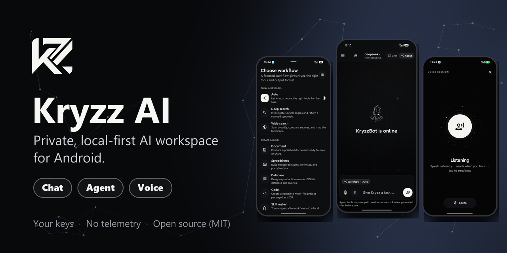
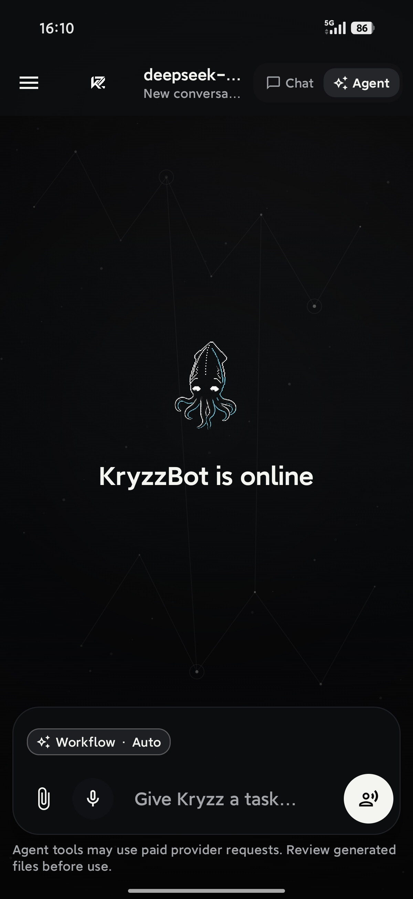
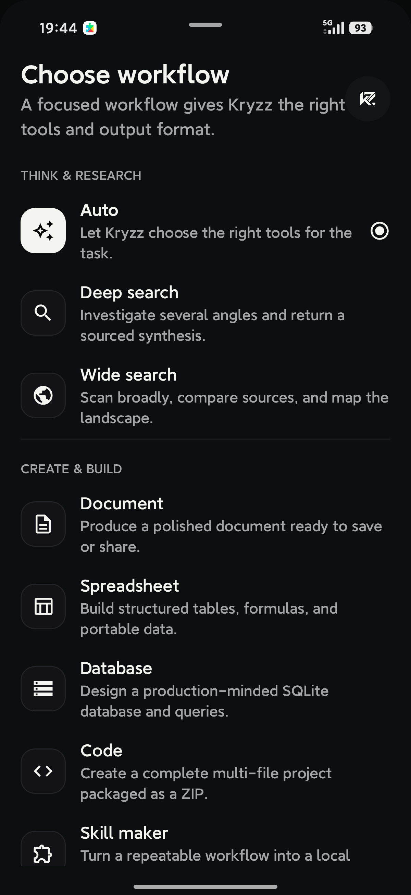
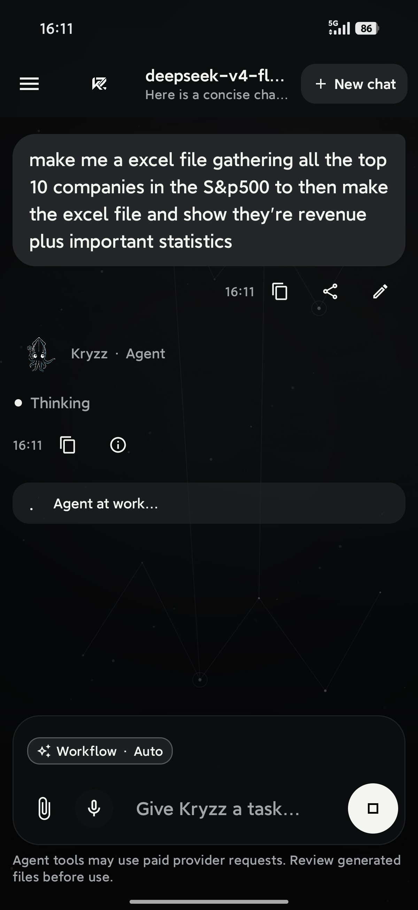
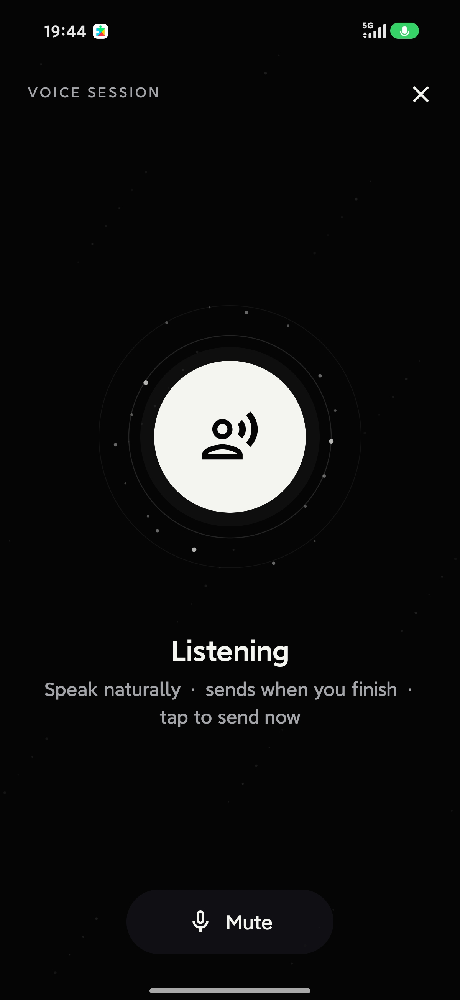
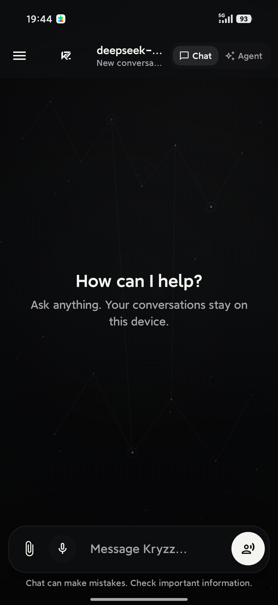
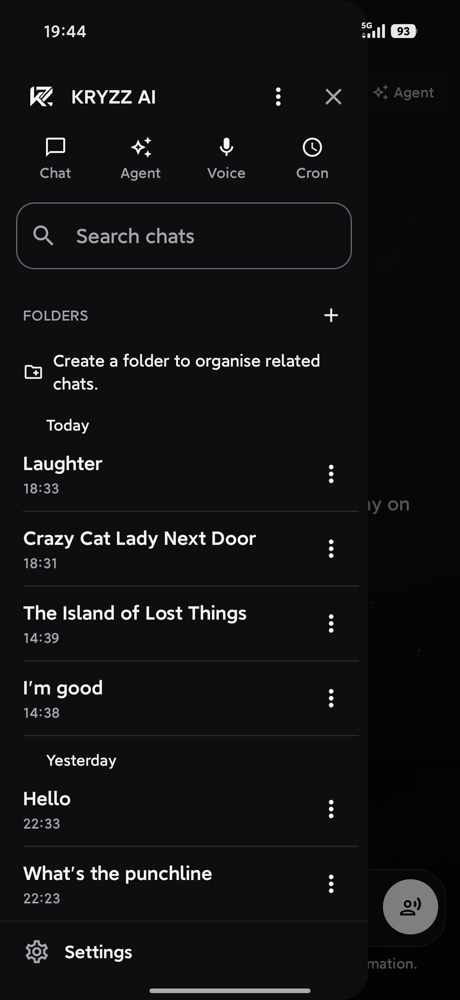
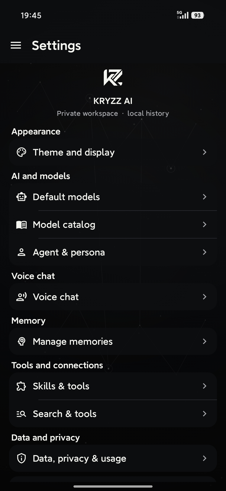
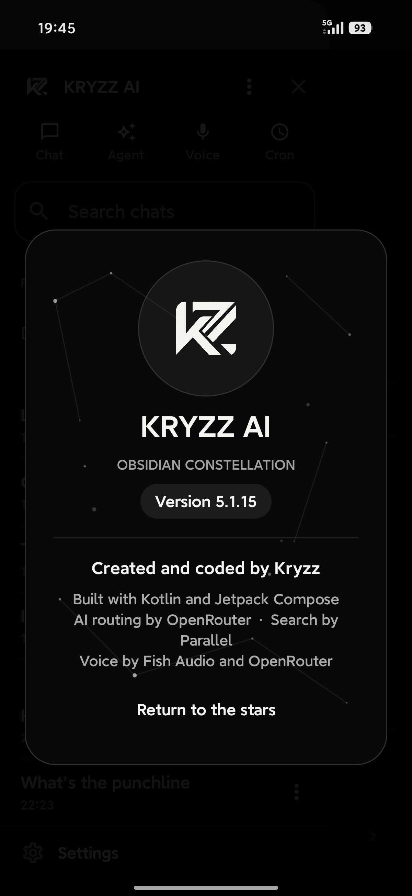

<p align="center">
  
</p>

# Kryzz AI

**A private AI workspace for Android: chat, autonomous agents, and voice in one app, running on your own API keys.** No account, no subscription, no telemetry. Your conversations stay on your phone.

[](https://github.com/kriddss3/kryzz-ai/releases/latest)

[](https://github.com/kriddss3/kryzz-ai/releases/latest)
[](https://github.com/kriddss3/kryzz-ai/releases)
[](https://github.com/kriddss3/kryzz-ai/stargazers)
[](./LICENSE)


<p align="center">
  
  
  
  
</p>

---

## Install in 60 seconds

1. **Download** `kryzz-ai-5.11.0-debug.apk` (about 82 MB) from the [latest release](https://github.com/kriddss3/kryzz-ai/releases/latest).
2. **Allow it to install.** Android 9+: *Settings → Apps → Special access → Install unknown apps*, then allow your browser or file manager.
3. **Open Kryzz AI**, paste an [OpenRouter key](https://openrouter.ai/keys), test it in the onboarding screen, and start talking to it.

Prefer automatic updates? Add `https://github.com/kriddss3/kryzz-ai` to [Obtainium](https://github.com/ImranR98/Obtainium) and it will notify you when a new release lands.

> The APK is a **debug-signed build** meant for evaluation and sideloading. Details and caveats are [below](#download-details).

---

## Why Kryzz AI

- **Your keys, your data.** You bring the API keys. They are stored encrypted under a non-exportable Android Keystore key and are never sent anywhere except the provider you chose.
- **Nothing phones home.** No bundled keys, no analytics, no telemetry, no HTTP logging. Android backup and device-to-device transfer are off.
- **Three modes, one app.** Chat for conversations, Agent for multi-step tool work, Voice for hands-free talking with barge-in.
- **Real files out, not just text.** The agent can hand back DOCX, XLSX, PDF, SQLite, and code ZIPs, stored in private app storage until you share them.
- **Any model you like.** Pick from the OpenRouter catalog, or switch to MiniMax. You pay your provider directly for what you use, and Agent mode has a per-turn cost cap (default $0.25).
- **Open source, MIT.** Read it, fork it, build it yourself. 400 unit tests.

### How it compares

| | Typical hosted AI app | Kryzz AI |
| --- | --- | --- |
| Account and subscription | Sign-up, monthly plan | None. Pay your provider per use |
| API keys | Held by the vendor | Yours, encrypted on-device |
| Conversation history | On the vendor's servers | On your phone (Room database) |
| Analytics / telemetry | Usually | None |
| Model choice | Whatever the vendor offers | Any model on OpenRouter, or MiniMax |
| Source code | Closed | MIT, in this repo |

One honest note: your prompts do go to the model provider you select (that is how the models run). Kryzz does not add anyone else in the middle.

---

## What you can do

- **Chat.** Streamed conversations with a model you pick, attachments, reasoning controls, editing, regeneration, cancellation, citations, token usage, and cost details. The model can also ask you a question with tappable options instead of guessing.
- **Agent.** Bounded tool workflows, deep research, wide web search, content creation, reusable local skills, and generated files. Auto can search, fetch an allowed page, do arithmetic, check the weather, remember facts, schedule a reminder, keep a live plan, and produce documents, spreadsheets, PDFs, or code zips. Fast / Balanced / Max sits on the composer.
- **Voice.** Microphone transcription, spoken replies, automatic turn-taking, and barge-in to interrupt Kryzz mid-sentence.
- **Memory.** Local, searchable, categorized, per-entry enable/disable, with optional cross-chat recall during conversation.
- **Library.** Pin, folder, search, rename, delete, and JSON-import/export your conversations and skills.
- **Generated outputs.** DOCX, XLSX, PDF, SQLite, code ZIPs, images, video, and music, kept in private app storage until you share them. Documents, spreadsheets, and PDFs share one Markdown model, including typed cells and multi-sheet workbooks.

Multimodal attachments and generated media require a model that supports them. Search and voice features need the relevant provider configured.

<details>
<summary><b>More screenshots</b></summary>

| New chat | Agent workflows |
| :------: | :-------------: |
|  |  |

| Voice session | Side drawer |
| :------------: | :---------: |
|  |  |

| Settings | About |
| :------: | :---: |
|  |  |

</details>

---

## What's new in v1.1.2

Since public v1.1 (internal 5.7.2). This drop is internal **5.11.0**.

- **Live plan card.** Agent Auto keeps a checklist through the turn. Planning steps do not eat the work budget.
- **Safer page reads.** `fetch_url` only opens a link you shared, a search result from this chat, or a site you named.
- **Review before send.** Substantial answers get one check against the tool results. Short questions skip it.
- **Cost cap.** Default $0.25 per turn, adjustable up to $2. Hitting the cap still finishes the answer.
- **Fast / Balanced / Max.** A chip on the Agent composer. Max uses the strongest model, a 24-step budget, and the review pass.
- **Finished files.** DOCX, XLSX, and PDF share one Markdown model: real headings, lists, tables, typed spreadsheet cells, multi-sheet workbooks, and Unicode PDFs.
- **Work log.** Each agent answer can show what it did ("3 searches · read 4 pages · 1 file") and expand into the steps. Activity chips name the query, page, or place.

See [`CHANGELOG.md`](./CHANGELOG.md). This drop's notes: [`RELEASE_NOTES_5.11.0.md`](./RELEASE_NOTES_5.11.0.md). Older public notes: [`RELEASE_NOTES_5.7.2.md`](./RELEASE_NOTES_5.7.2.md) (v1.1) and [`RELEASE_NOTES_5.1.15.md`](./RELEASE_NOTES_5.1.15.md) (v1.0).

**Version numbering.** Public **v1.1.2** is internal build **5.11.0** (versionCode 84). Public v1.1 was internal 5.7.2, and public v1.0 was internal 5.1.15. Builds 1.x through 5.1.14 were never published, and there is no public v1.1.1.

---

## FAQ

**Is it free?** The app is free and MIT-licensed. You pay your model provider (OpenRouter, MiniMax, and so on) for what you use. Agent mode stops spending at a per-turn cap you control.

**Do I need an API key?** Yes. OpenRouter is required for voice transcription and for OpenRouter chat and media. MiniMax, Parallel (web research), and Fish Audio (voice synthesis) are optional.

**Does it run models on my phone?** No. Kryzz is a client for hosted model APIs. "Local-first" means your conversations, memory, files and keys live on the device. The models themselves run at the provider you choose.

**Is it on the Play Store?** No. It is distributed as a GitHub release, and Obtainium can handle updates.

**Why a debug APK?** Debug builds are signed with the standard Android debug key, which is fine for evaluation and sideloading and lets v1.0, v1.1, and v1.1.2 upgrade in place. If you want a long-term install on a daily driver, [build your own signed release](#release-signing).

**Where is my data?** On your device, in a Room database and DataStore. Conversation backups never include credentials. See [Privacy](#privacy-in-one-breath).

**Something broke or I want a feature.** [Open an issue](https://github.com/kriddss3/kryzz-ai/issues). If Kryzz AI is useful to you, a star helps others find it.

---

## Download details

A pre-built debug APK for the source in this repository is published as a **GitHub Release**:

👉 **[`v1.1.2` release page →](https://github.com/kriddss3/kryzz-ai/releases/tag/v1.1.2)** — download `kryzz-ai-5.11.0-debug.apk` (debug-signed).

A copy of the same APK is also committed in this repo at:

```
work-assets/releases/kryzz-ai-5.11.0-debug.apk
```

Debug-signed with the Android Studio default key, package `ai.daylight.assistant.debug`.

Previous public builds stay up: [`v1.1`](https://github.com/kriddss3/kryzz-ai/releases/tag/v1.1) (`kryzz-ai-5.7.2-debug.apk`) and [`kryzz-AI-v1-(debug)`](https://github.com/kriddss3/kryzz-ai/releases/tag/kryzz-AI-v1-(debug)) (`kryzz-ai-5.1.15-debug.apk`).

> This is a debug build meant for evaluation and sideloading. For long-term installs on a daily-driver device, build your own signed release APK from this source.
>
> The debug package id is `ai.daylight.assistant.debug`. versionCode 84 upgrades in place over the v1.1 and v1.0 debug APKs. It will **not** replace a separately signed `ai.daylight.assistant` release install.

---

## Privacy, in one breath

- Everything you write or save is stored locally on the device (Room + DataStore).
- Credentials are encrypted with **AES-GCM** under a non-exportable **Android Keystore** key. They are never sent anywhere.
- Conversation **backups** never include credentials.
- Android backup, device-to-device transfer, cleartext traffic, and HTTP logging are all **disabled**.
- The microphone is only active during a voice session; recorded audio is cached for transcription only and deleted afterward.
- Optional **coarse location** is used only when you enable Location in Settings, and only as text in requests you already send (weather / “nearby”).

One small thing: for a fresh conversation's auto-title, Kryzz may send at most the first 1,500 characters of your first message through OpenRouter to a small model (Gemini 2.5 Flash Lite) for naming. This runs in parallel with your first answer, never blocks it, and falls back to a local title if it can't complete.

---

## Providers you'll need

- **OpenRouter**: required for voice transcription and for OpenRouter chat/media. Also used for OpenRouter TTS.
- **MiniMax** *(optional)*: alternative chat, agent, and media provider (Token Plan Global). Switching providers resets model defaults to that catalog.
- **Parallel** *(optional)*: used only for explicit web search and research workflows.
- **Fish Audio** *(optional)*: for Fish-hosted voice synthesis; OpenRouter TTS also works.

Voice transcription stays on OpenRouter even when MiniMax is the chat provider.

You enter keys only inside the installed app. They are not part of this repository and not needed to build it.

### First run

1. Install the APK and launch Kryzz AI.
2. Enter an OpenRouter key (needed for voice, and for OpenRouter chat).
3. Test the key in the onboarding screen.
4. *(Optional)* Switch the chat provider to MiniMax and enter a MiniMax key.
5. *(Optional)* Enter a Parallel key for web research.
6. *(Optional)* Pick a voice provider (Fish Audio or OpenRouter TTS).
7. *(Optional)* Toggle cross-chat memory.

---

## Build from source

**Requirements:** JDK 17, Android SDK platform 35, Android Build Tools 35.0.0, and network access for the first Gradle dependency resolution. Minimum runtime is **Android 9 / API 28**. The wrapper is **Gradle 8.9**.

```powershell
.\gradlew.bat assembleDebug
```

Unit tests:

```powershell
.\gradlew.bat testDebugUnitTest
```

Android instrumented tests (needs an emulator or device connected):

```powershell
.\gradlew.bat connectedDebugAndroidTest
```

The debug APK is written to:

```
app/build/outputs/apk/debug/app-debug.apk
```

Debug package: `ai.daylight.assistant.debug`.
Release package: `ai.daylight.assistant`.

### Release signing

Signing material is **never** committed. Production credentials are read only from environment variables:

```powershell
$env:KRYZZ_KEYSTORE='C:\secure\kryzz-release.jks'
$env:KRYZZ_STORE_PASSWORD='<store password>'
$env:KRYZZ_KEY_ALIAS='kryzz-release'
$env:KRYZZ_KEY_PASSWORD='<key password>'
.\gradlew.bat assembleRelease
```

Without those variables Gradle produces an unsigned release build. The signing certificate must match any version already installed on a user's device for in-place upgrades to work.

---

## Architecture (one-screen tour)

| Layer         | Responsibility                                                                |
| ------------- | ----------------------------------------------------------------------------- |
| `data/local`  | Room entities, DAO, migrations, DB schema                                     |
| `data/prefs`  | DataStore-backed settings + legacy-value coercion                             |
| `data/remote` | Provider clients, request schemas, streaming, MiniMax media, error handling   |
| `security`    | Android-Keystore-backed credential encryption                                 |
| `domain`      | Agent loop, quality presets, plan, review, files, citations, question cards  |
| `voice`       | Recording, playback, adaptive turn detection, session state                   |
| `ui`          | Compose navigation, screens, drawer, design system, ViewModels, KryzzBot      |

**Stack:** Kotlin · Jetpack Compose (Material 3) · Coroutines / Flow · Room · DataStore · OkHttp · MVVM.

### Repository layout

```
app/                     ← Kotlin source, Android resources, tests, Room schemas
build.gradle.kts
settings.gradle.kts
gradle/  gradlew*        ← Gradle wrapper
CHANGELOG.md             ← public v1.0 → v1.1.2 summary
RELEASE_NOTES_5.11.0.md  ← v1.1.2 internal notes
RELEASE_NOTES_5.1.15.md  ← v1.0 internal notes
RELEASE_NOTES_5.7.2.md   ← v1.1 internal notes
work-assets/
  ├── social-preview.png ← README header and GitHub social card
  ├── screenshots/       ← screenshots embedded in this README
  ├── releases/          ← compiled APKs (debug-signed, eval-only)
  ├── kryzz-mark-chroma.png
  └── qa-4.0.1/          ← older QA assets (historical reference)
```

---

## License

MIT — see [`LICENSE`](./LICENSE).

Copyright (c) 2026 Kristofers Kemers.
