<p align="center">
  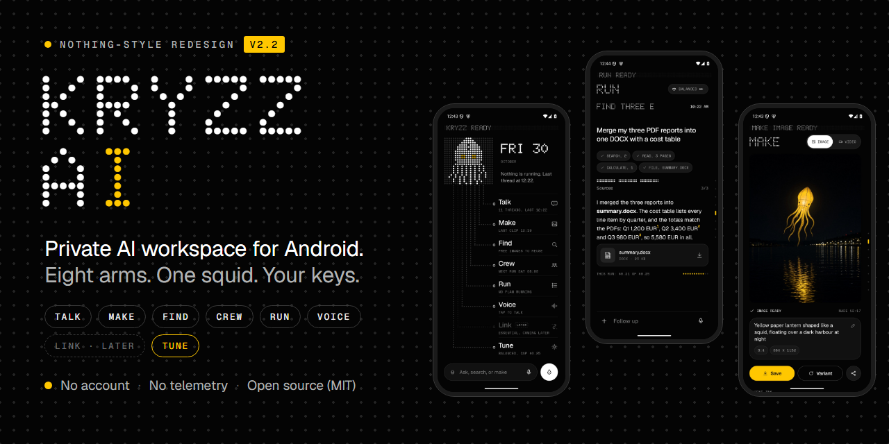
</p>

# Kryzz AI

**A private AI workspace for Android: chat, autonomous runs, voice, images, free-to-reuse image search and personal bots in one app, running on your own API keys.** No account, no subscription, no telemetry. Your conversations stay on your phone.

v2.0 is a full redesign in a Nothing-style dot-matrix look: black and white, one yellow accent, LED type, and a Home board with eight "arms".

[](https://github.com/kriddss3/kryzz-ai/releases/latest)

[](https://github.com/kriddss3/kryzz-ai/releases/latest)
[](https://github.com/kriddss3/kryzz-ai/releases)
[](https://github.com/kriddss3/kryzz-ai/stargazers)
[](./LICENSE)


<p align="center">
  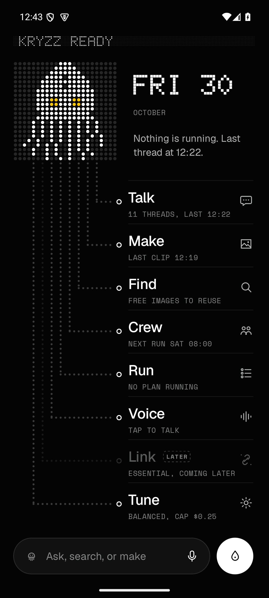
  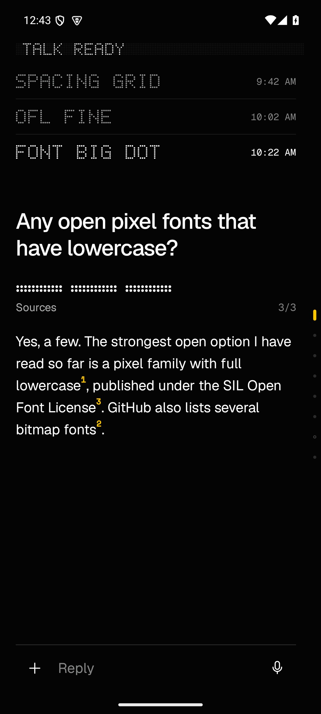
  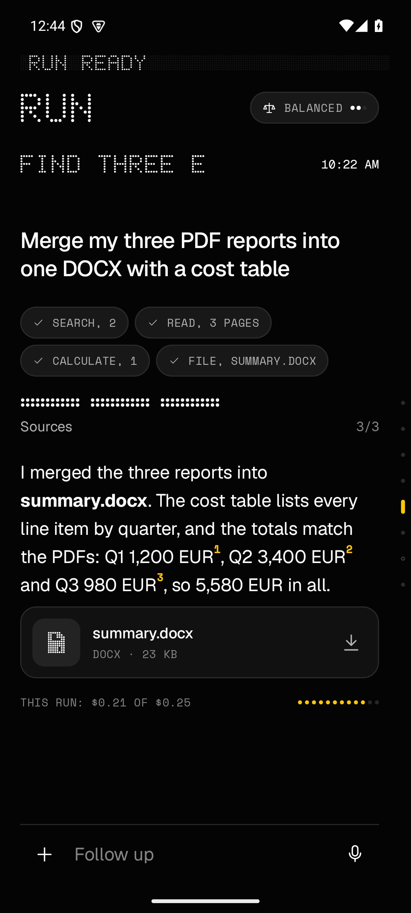
  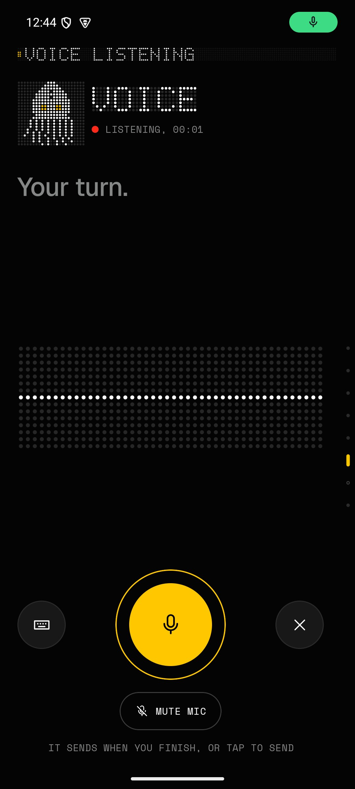
</p>

---

## Install in 60 seconds

1. **Download** `kryzz-ai-5.12.14-release.apk` (about 7 MB) from the [latest release](https://github.com/kriddss3/kryzz-ai/releases/latest).
2. **Allow it to install.** Android 9+: *Settings → Apps → Special access → Install unknown apps*, then allow your browser or file manager.
3. **Open Kryzz AI**, paste an [OpenRouter key](https://openrouter.ai/keys), test it in the onboarding screen, and start talking to it.

Prefer automatic updates? Add `https://github.com/kriddss3/kryzz-ai` to [Obtainium](https://github.com/ImranR98/Obtainium), set its APK filter to `release`, and it will notify you when a new release lands.

> The release APK is signed with a release key (certificate SHA-256 in [Download details](#download-details)). If you already run a v1.x **debug** build and want to upgrade in place, use the debug APK instead. The two builds are separate apps and do not share data. Either way, v2.0 installs over v1.1.2 of the same kind and keeps your chats, keys and settings.

---

## Why Kryzz AI

- **Your keys, your data.** You bring the API keys. They are stored encrypted under a non-exportable Android Keystore key and are never sent anywhere except the provider you chose.
- **Nothing phones home.** No bundled keys, no analytics, no telemetry, no HTTP logging. Android backup and device-to-device transfer are off.
- **Eight arms, one app.** Talk for conversations, Run for multi-step tool work, Voice for hands-free talking with barge-in, Make for images and clips, Find for free-to-reuse images, Crew for bots that work on a schedule, and Tune for settings. An 8-dot rail on the right edge switches between them.
- **Real files out, not just text.** Run can hand back DOCX, XLSX, PDF, SQLite, and code ZIPs, stored in private app storage until you share them. The Inkwell collects everything Kryzz made.
- **Any model you like.** Pick from the OpenRouter catalog, or switch to MiniMax. You pay your provider directly for what you use, and Run has a per-run cost cap (default $0.25).
- **Open source, MIT.** Read it, fork it, build it yourself. 780 unit tests.

### How it compares

| | Typical hosted AI app | Kryzz AI |
| --- | --- | --- |
| Account and subscription | Sign-up, monthly plan | None. Pay your provider per use |
| API keys | Held by the vendor | Yours, encrypted on-device |
| Conversation history | On the vendor's servers | On your phone (Room database) |
| Analytics / telemetry | Usually | None |
| Model choice | Whatever the vendor offers | Any model on OpenRouter, or MiniMax |
| Source code | Closed | MIT, in this repo |

One honest note: your prompts do go to the model provider you select (that is how the models run). Kryzz does not add anyone else in the middle.

---

## What you can do

- **Home.** The start screen: a board of the eight arms, each with a live caption ("11 threads, last 12:22", "Next run Sat 08:00"). Lit cables and the squid show what is running. Ask, search, or make from the bar at the bottom.
- **Talk.** Streamed conversations with a model you pick, attachments, reasoning controls, editing, regeneration, cancellation, citations with a source readout, token usage, and cost details. Queue a follow-up while an answer is still streaming. The model can also ask you a question with tappable options instead of guessing.
- **Run.** Bounded tool workflows, deep research, wide web search, content creation, reusable local skills, and generated files. Auto can search, fetch an allowed page, do arithmetic, check the weather, remember facts, schedule a reminder, keep a live plan card, and produce documents, spreadsheets, PDFs, or code zips. Fast / Balanced / Max sits in the header.
- **Voice.** Microphone transcription, spoken replies, automatic turn-taking, barge-in to interrupt Kryzz mid-sentence, and a mute pill.
- **Make.** Images and short clips from your image and video models, with only the aspect ratios the provider supports. Renders keep going when you leave; save to the gallery or share.
- **Find.** Search Wikimedia Commons for images you may reuse, filtered by type, licence and size. Every save and share carries the credit line.
- **Crew.** Bots with a name, persona and dot avatar. Each has its own chat, and its routines run on a schedule inside that chat.
- **Inkwell.** Every image, clip and file Kryzz made, in one feed.
- **Memory.** Local, searchable, categorized, per-entry enable/disable, with optional cross-chat recall during conversation.
- **Library.** A left drawer: pin, folder, search, rename, delete, and JSON-import/export your conversations.
- **Generated outputs.** DOCX, XLSX, PDF, SQLite, code ZIPs, images, video, and music, kept in private app storage until you share them. Documents, spreadsheets, and PDFs share one Markdown model, including typed cells and multi-sheet workbooks.
- **Tune.** Thinking mode, the cost cap, keys, models, privacy switches, Dark / Light / Auto, text size and motion, all on one page.

Multimodal attachments and generated media require a model that supports them. Search and voice features need the relevant provider configured.

<details>
<summary><b>More screenshots</b></summary>

| Make | Find |
| :--: | :--: |
| 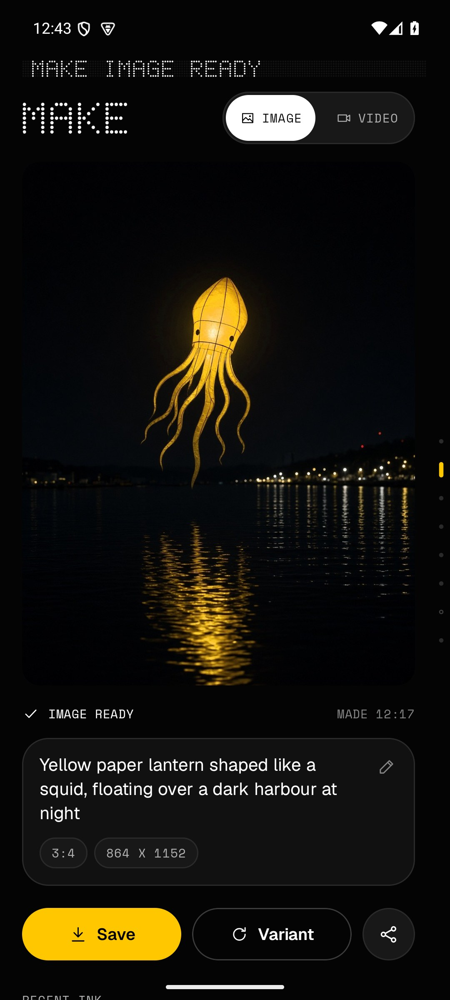 | 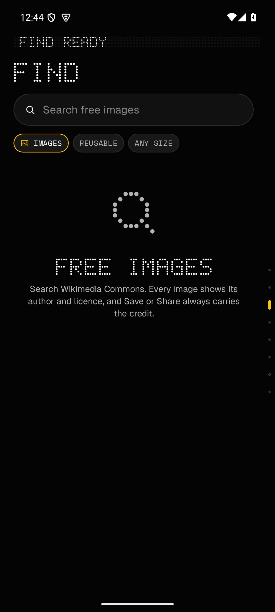 |

| Crew | Inkwell |
| :--: | :-----: |
| 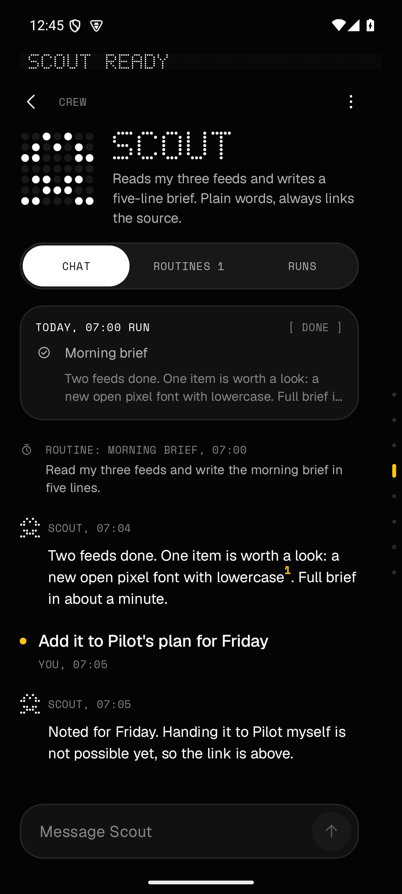 | 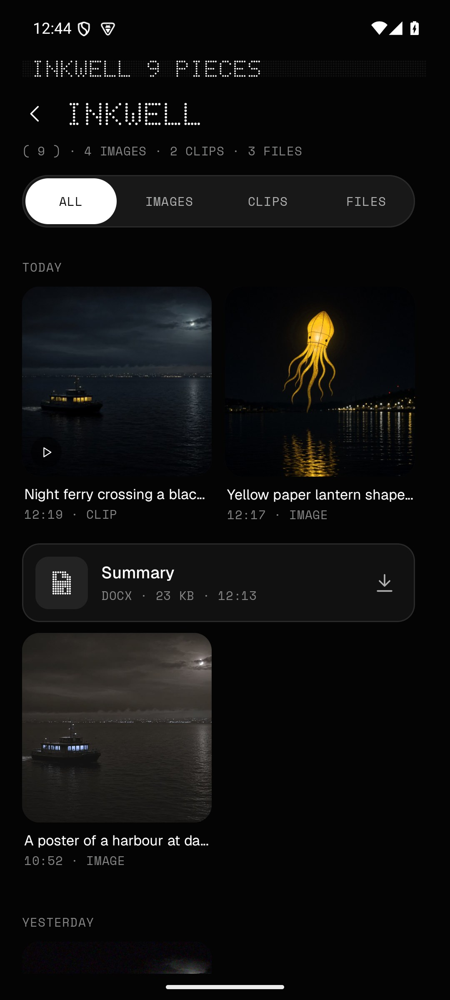 |

| Tune | Chat library |
| :--: | :----------: |
| 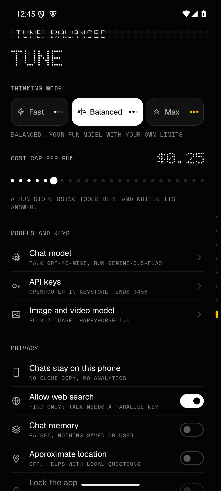 | 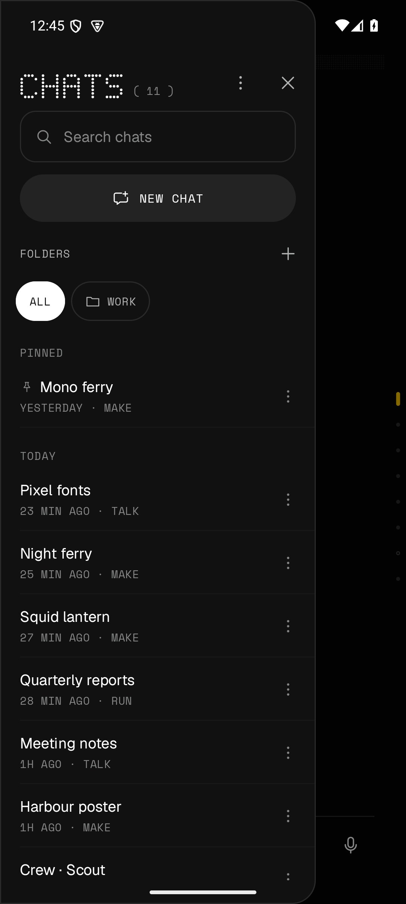 |

| Light theme | Run in light |
| :---------: | :----------: |
| 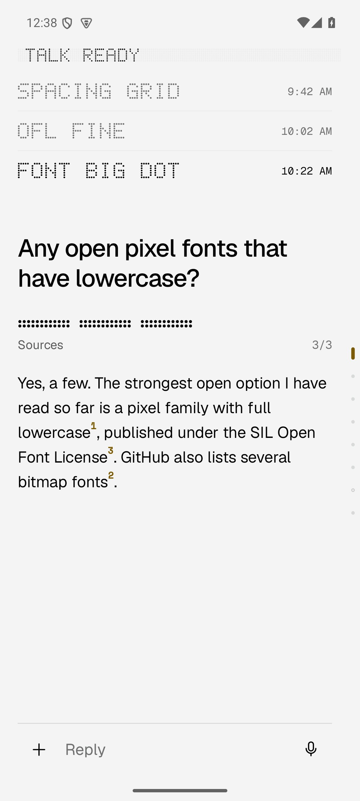 | 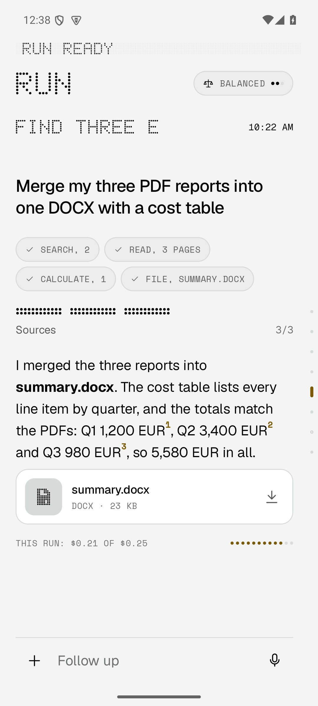 |

</details>

---

## What's new in v2.0

Since public v1.1.2 (internal 5.11.0). This drop is internal **5.12.14**.

- **A new look.** Black and white, one yellow accent, dot-matrix type, and stepped LED motion, in Dark, Light or Auto.
- **Home and the arm rail.** A board of eight arms is the start screen, and an 8-dot rail on the right edge switches arms from anywhere. An LED strip at the top says what the screen is doing.
- **Talk and Run.** Chat and Agent, rebuilt: a departure board of earlier questions, source readouts, a live plan card, work chips, file cards and a cost line.
- **New: Make, Find, Crew and the Inkwell.** An image and clip studio, free-to-reuse image search with credits, personal bots with scheduled routines, and one feed of everything Kryzz made.
- **Safer restores.** Importing a backup on the same phone now merges instead of deleting newer messages and files.

See [`CHANGELOG.md`](./CHANGELOG.md). This drop's notes: [`RELEASE_NOTES_5.12.14.md`](./RELEASE_NOTES_5.12.14.md). Older public notes: [`RELEASE_NOTES_5.11.0.md`](./RELEASE_NOTES_5.11.0.md) (v1.1.2), [`RELEASE_NOTES_5.7.2.md`](./RELEASE_NOTES_5.7.2.md) (v1.1) and [`RELEASE_NOTES_5.1.15.md`](./RELEASE_NOTES_5.1.15.md) (v1.0).

**Version numbering.** Public **v2.0** is internal build **5.12.14** (versionCode 99). Public v1.1.2 was internal 5.11.0, v1.1 was internal 5.7.2, and v1.0 was internal 5.1.15. Builds 1.x through 5.1.14 and 5.12.0 through 5.12.13 were never published, and there is no public v1.1.1.

---

## FAQ

**Is it free?** The app is free and MIT-licensed. You pay your model provider (OpenRouter, MiniMax, and so on) for what you use. Agent mode stops spending at a per-turn cap you control.

**Do I need an API key?** Yes. OpenRouter is required for voice transcription and for OpenRouter chat and media. MiniMax, Parallel (web research), and Fish Audio (voice synthesis) are optional.

**Does it run models on my phone?** No. Kryzz is a client for hosted model APIs. "Local-first" means your conversations, memory, files and keys live on the device. The models themselves run at the provider you choose.

**Is it on the Play Store?** No. It is distributed as a GitHub release, and Obtainium can handle updates.

**Release or debug APK?** Take the release APK for a new install: it is smaller and signed with a release key. The debug APK exists so that people who already installed a v1.x debug build can upgrade in place. The two have different package names (`ai.daylight.assistant` and `ai.daylight.assistant.debug`), install side by side, and do not share data. You can also [build and sign your own](#release-signing).

**Where is my data?** On your device, in a Room database and DataStore. Conversation backups never include credentials. See [Privacy](#privacy-in-one-breath).

**Something broke or I want a feature.** [Open an issue](https://github.com/kriddss3/kryzz-ai/issues). If Kryzz AI is useful to you, a star helps others find it.

---

## Download details

Both APKs for the source in this repository are published on the **GitHub Release** page:

👉 **[`v2.0` release page →](https://github.com/kriddss3/kryzz-ai/releases/tag/v2.0)**

| File | Package | Signing | Use it when |
| --- | --- | --- | --- |
| `kryzz-ai-5.12.14-release.apk` (about 7 MB) | `ai.daylight.assistant` | Release key | New installs (recommended) |
| `kryzz-ai-5.12.14-debug.apk` (about 70 MB) | `ai.daylight.assistant.debug` | Android debug key | Upgrading in place over a v1.x debug build |

Release signing certificate SHA-256: `5922776bff28cda04b1b8a3bd71d815b420bc9e3b73890e78b3bfcde3c7c91e3`. Check a download with `apksigner verify --print-certs kryzz-ai-5.12.14-release.apk`. File checksums are on the release page.

The v1.1.2 debug APK is also committed in this repo at `work-assets/releases/kryzz-ai-5.11.0-debug.apk`.

Previous public builds stay up: [`v1.1.2`](https://github.com/kriddss3/kryzz-ai/releases/tag/v1.1.2) (`kryzz-ai-5.11.0-release.apk`, `kryzz-ai-5.11.0-debug.apk`), [`v1.1`](https://github.com/kriddss3/kryzz-ai/releases/tag/v1.1) (`kryzz-ai-5.7.2-debug.apk`) and [`kryzz-AI-v1-(debug)`](https://github.com/kriddss3/kryzz-ai/releases/tag/kryzz-AI-v1-(debug)) (`kryzz-ai-5.1.15-debug.apk`).

> versionCode 99 upgrades in place over every earlier public build of the same kind: the release APK over the v1.1.2 release APK, the debug APK over the v1.x debug APKs. The database moves to version 13 on first launch and keeps your chats. The release and debug APKs are separate apps and will not replace each other.

---

## Privacy, in one breath

- Everything you write or save is stored locally on the device (Room + DataStore).
- Credentials are encrypted with **AES-GCM** under a non-exportable **Android Keystore** key. They are never sent anywhere.
- Conversation **backups** never include credentials.
- Android backup, device-to-device transfer, cleartext traffic, and HTTP logging are all **disabled**.
- The microphone is only active during a voice session; recorded audio is cached for transcription only and deleted afterward.
- Optional **coarse location** is used only when you enable Location in Tune, and only as text in requests you already send (weather / “nearby”).
- **Make** writes to your gallery (`Pictures/Kryzz`, `Movies/Kryzz`) only when you tap Save.
- **Crew** routines run on a schedule only while their switch is on, with your own keys, and their results stay in the bot's chat on the phone.
- **Find** searches **Wikimedia Commons** (`commons.wikimedia.org`, no key) and loads images from Wikimedia's media hosts (`upload.wikimedia.org`, `thumb.wikimedia.org`). It sends only your search words and filters, and it is off whenever *Allow web search* is off. Saved and shared images carry their credit line (author, licence and source).

One small thing: for a fresh conversation's auto-title, Kryzz may send at most the first 1,500 characters of your first message through OpenRouter to a small model (Gemini 2.5 Flash Lite) for naming. This runs in parallel with your first answer, never blocks it, and falls back to a local title if it can't complete.

---

## Providers you'll need

- **OpenRouter**: required for voice transcription and for OpenRouter chat/media. Also used for OpenRouter TTS.
- **MiniMax** *(optional)*: alternative chat, agent, and media provider (Token Plan Global). Switching providers resets model defaults to that catalog.
- **Parallel** *(optional)*: used only for explicit web search and research workflows.
- **Fish Audio** *(optional)*: for Fish-hosted voice synthesis; OpenRouter TTS also works.

Voice transcription stays on OpenRouter even when MiniMax is the chat provider.

You enter keys only inside the installed app. They are not part of this repository and not needed to build it.

### First run

Onboarding has four short steps, and you land on Home after the last one.

1. **Local first.** What stays on the phone.
2. **Your keys.** Paste an OpenRouter key and test it (needed for voice, and for OpenRouter chat). Parallel and Fish Audio keys are optional on the same step.
3. **Memory.** Turn cross-chat memory on or off.
4. **Privacy.** Allow approximate location or not, then Start.

Later, in **Tune**: switch the chat provider to MiniMax under *API keys*, and pick a voice provider (Fish Audio or OpenRouter TTS) under *Voice*.

---

## Build from source

**Requirements:** JDK 17, Android SDK platform 35, Android Build Tools 35.0.0, and network access for the first Gradle dependency resolution. Minimum runtime is **Android 9 / API 28**. The wrapper is **Gradle 8.9**.

```powershell
.\gradlew.bat assembleDebug
```

Unit tests:

```powershell
.\gradlew.bat testDebugUnitTest
```

Android instrumented tests (needs an emulator or device connected):

```powershell
.\gradlew.bat connectedDebugAndroidTest
```

The debug APK is written to:

```
app/build/outputs/apk/debug/app-debug.apk
```

Debug package: `ai.daylight.assistant.debug`.
Release package: `ai.daylight.assistant`.

### Release signing

Signing material is **never** committed. Production credentials are read only from environment variables:

```powershell
$env:KRYZZ_KEYSTORE='C:\secure\kryzz-release.jks'
$env:KRYZZ_STORE_PASSWORD='<store password>'
$env:KRYZZ_KEY_ALIAS='kryzz-release'
$env:KRYZZ_KEY_PASSWORD='<key password>'
.\gradlew.bat assembleRelease
```

Without those variables Gradle produces an unsigned release build. The signing certificate must match any version already installed on a user's device for in-place upgrades to work.

---

## Architecture (one-screen tour)

| Layer         | Responsibility                                                                |
| ------------- | ----------------------------------------------------------------------------- |
| `data/local`  | Room entities, DAO, migrations, DB schema                                     |
| `data/prefs`  | DataStore-backed settings + legacy-value coercion                             |
| `data/remote` | Provider clients, request schemas, streaming, MiniMax media, error handling   |
| `security`    | Android-Keystore-backed credential encryption                                 |
| `domain`      | Agent loop, quality presets, plan, review, files, citations, question cards, Make studio, Find session, Crew desk |
| `voice`       | Recording, playback, adaptive turn detection, session state                   |
| `ui/dot`      | The Dot design system: palette, type, controls, dot-matrix effects, the squid |
| `ui/shell`    | Arm rail, ink strip, screen Back handling                                     |
| `ui`          | Navigation, one package per arm (home, talk, run, voice, make, find, crew, tune, inkwell, library), ViewModels |

**Stack:** Kotlin · Jetpack Compose (Material 3) · Coroutines / Flow · Room · DataStore · OkHttp · MVVM.

### Repository layout

```
app/                     ← Kotlin source, Android resources, tests, Room schemas
build.gradle.kts
settings.gradle.kts
gradle/  gradlew*        ← Gradle wrapper
CHANGELOG.md             ← public v1.0 → v2.0 summary
RELEASE_NOTES_5.12.14.md ← v2.0 internal notes
RELEASE_NOTES_5.11.0.md  ← v1.1.2 internal notes
RELEASE_NOTES_5.1.15.md  ← v1.0 internal notes
RELEASE_NOTES_5.7.2.md   ← v1.1 internal notes
work-assets/
  ├── social-preview.png ← README header and GitHub social card
  ├── screenshots/       ← screenshots embedded in this README
  ├── releases/          ← compiled APKs (debug-signed, eval-only)
  ├── kryzz-mark-chroma.png
  └── qa-4.0.1/          ← older QA assets (historical reference)
```

---

## License

MIT — see [`LICENSE`](./LICENSE).

Copyright (c) 2026 Kristofers Kemers.
